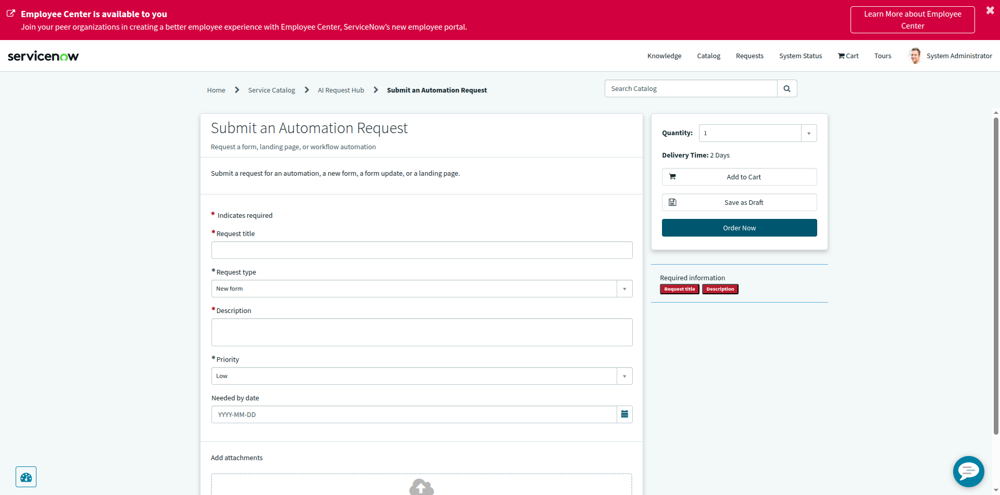

# AI Request Hub — Catalog v1 (Build Report)

| | |
|---|---|
| **Instance** | `dev446072.service-now.com` (PDI) |
| **Action** | Explicitly authorized configuration build — new Update Set, Catalog Category, Catalog Item, 5 variables, end-user verification |
| **Date** | 2026-10-18 |
| **Tool used** | Playwright MCP (browser automation) |

---

## 1. Update Set

| Field | Value |
|---|---|
| **Name** | `[AI DEMO] AI Request Hub - Catalog v1` |
| **sys_id** | `6654e7f493041b1075d9f9fbdd03d637` |
| **State** | **In Progress** |
| **Current** | ✅ Yes — made current via "Make This My Current Set", confirmed in `sys_user_preference` (`sys_update_set` value matches this set's sys_id for System Administrator) |
| **Application** | Global |

Not exported, imported, previewed, committed, or completed — left exactly as "In Progress" and current, per instructions.

## 2. Catalog Category — "AI Request Hub"

| Field | Value |
|---|---|
| **Title** | AI Request Hub |
| **Description** | Demo catalog for AI-assisted request forms |
| **Active** | true |
| **Parent** | (none — top-level) |
| **Catalog** | Service Catalog (`e0d08b13c3330100c8b837659bba8fb4`) — the default active catalog used by `/sp` |
| **sys_id** | `8545e7f093041b1075d9f9fbdd03d6b6` |

**Generated direct portal URL for the category:**
```
https://dev446072.service-now.com/sp?id=sc_category&sys_id=8545e7f093041b1075d9f9fbdd03d6b6
```

No existing category or catalog item was modified or deleted.

## 3. Catalog Item — "Submit an Automation Request"

| Field | Value |
|---|---|
| **Name** | Submit an Automation Request |
| **Short description** | Request a form, landing page, or workflow automation |
| **Description** | Submit a request for an automation, a new form, a form update, or a landing page. |
| **Catalog(s)** | Service Catalog |
| **Category** | AI Request Hub |
| **Active** | true |
| **sys_id** | `4e856b7893041b1075d9f9fbdd03d60c` |

**Generated direct portal URL for the catalog item:**
```
https://dev446072.service-now.com/sp?id=sc_cat_item&sys_id=4e856b7893041b1075d9f9fbdd03d60c&sysparm_category=8545e7f093041b1075d9f9fbdd03d6b6
```

## 4. Variables (added in order)

| # | Name | Label (Question) | Type | Mandatory | Order | Choices |
|---|---|---|---|---|---|---|
| 1 | `request_title` | Request title | Single Line Text | ✅ true | 100 | — |
| 2 | `request_type` | Request type | Select Box | ✅ true | 200 | New form, Update existing form, Landing page, Automation, Other |
| 3 | `description` | Description | Multi Line Text | ✅ true | 300 | — |
| 4 | `priority` | Priority | Select Box | ✅ true | 400 | Low, Medium, High |
| 5 | `needed_by_date` | Needed by date | Date | ❌ false | 500 | — |

All choice-type variables' options were added in the exact order specified and verified via direct table queries (`question_choice` list, `ORDERBY order`) before moving to the portal check.

## 5. End-user verification (no submission)

Navigated as an end user through: **Service Portal (`/sp`) → Catalog → AI Request Hub → Submit an Automation Request**.

Confirmed on the rendered form:
- All 5 variables are visible, in the correct order.
- **Request title**, **Request type**, **Description**, and **Priority** show the red required-asterisk (`*`) and are also listed in the "Required information" sidebar panel.
- **Needed by date** correctly shows **no** required asterisk (optional).
- "Request type" and "Priority" select boxes default to their first choice ("New form" and "Low" respectively), which is why they weren't flagged as missing in the sidebar even though they're mandatory — expected Select Box behavior (a choice field always has *some* value selected).
- Breadcrumb confirms correct placement: `Home > Service Catalog > AI Request Hub > Submit an Automation Request`.

**No submission occurred** — "Order Now", "Add to Cart", and "Save as Draft" were not clicked.

### Screenshot



---

## Summary of safety boundaries honored

- ✅ Created exactly one Update Set, kept In Progress, not exported/imported/previewed/committed.
- ✅ Created exactly one new top-level Catalog Category ("AI Request Hub").
- ✅ Created exactly one new active Catalog Item ("Submit an Automation Request"), linked to the default Service Catalog and the new category.
- ✅ Added exactly 5 variables, in the specified order, with the specified types/mandatory flags/choices.
- ✅ No existing catalog item or category was modified or deleted.
- ✅ Verified the form as an end user without submitting it.
