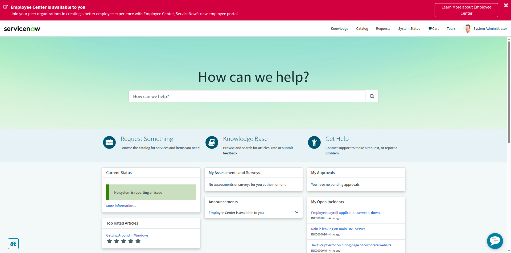
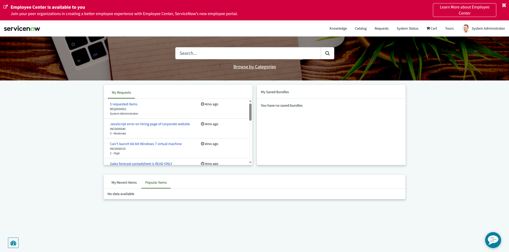
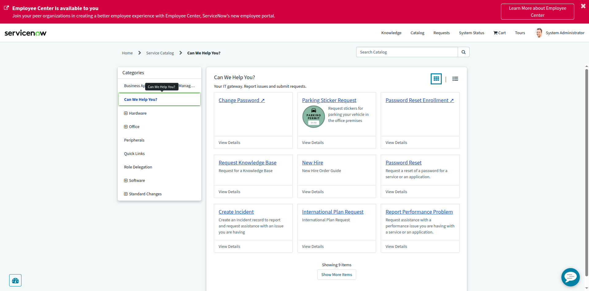
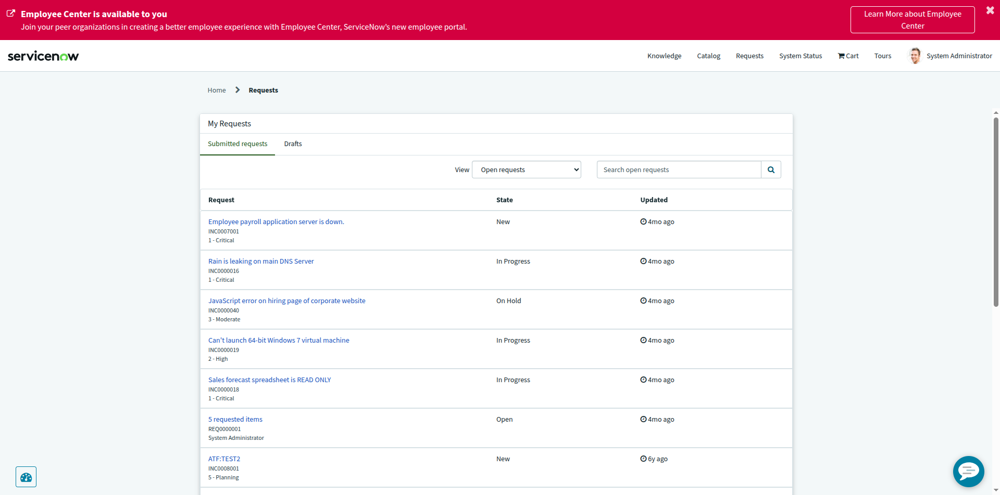

# AI Request Hub Discovery — Service Portal, Catalog & Requests

| | |
|---|---|
| **Instance** | `dev446072.service-now.com` (PDI) |
| **Task type** | Read-only discovery — nothing created, edited, deleted, submitted, imported, exported, or configured |
| **Date** | 2026-10-18 |
| **Tool used** | Playwright MCP (browser automation) |

---

## Summary table

| # | Item | Available? | Notes |
|---|---|---|---|
| 1 | Service Portal (`/sp`) | ✅ Yes | Fully functional OOB "Service Portal" theme, loads at `/sp` |
| 2 | Service Catalog | ✅ Yes | Accessible from portal nav ("Catalog") and classic UI |
| 3 | Catalog Items | ✅ Yes | **197** items total (classic `sc_cat_item_list.do`); 9 visible in the "Can We Help You?" category alone |
| 4 | Catalog Categories | ✅ Yes | **45** categories total (classic `sc_category_list.do`); 8 top-level categories visible in the portal |
| 5 | Requested Items / Requests list | ✅ Yes | Portal "Requests" page and classic `sc_req_item_list.do` both work; existing request REQ0000001 (5 requested items) found |

---

## 1. Service Portal

- **Public-facing URL**: `https://dev446072.service-now.com/sp`
- Loads the OOB Service Portal homepage ("Home Page - Service Portal") with:
  - Search bar ("How can we help?")
  - Quick Links: **Request Something** (→ catalog), **Knowledge Base**, **Get Help**
  - Widgets: Current Status, Top Rated Articles, My Approvals, My Open Incidents
- Top nav bar (once inside any portal page) exposes: **Knowledge**, **Catalog**, **Requests**, **System Status**, **Cart**, **Tours**, user menu.
- An "Employee Center is available to you" banner is shown — this PDI has Employee Center (the newer portal) available as an upgrade path, but has **not** migrated off the classic Service Portal; `/sp` is still the active default portal.

**Exact navigation path (from inside the portal):** Home → "Request Something" quick link, or top nav → **Catalog**.

## 2. Service Catalog

- **Portal path**: `/sp?id=sc_home` (Catalog Home) or `/sp?id=sc_category` (Catalog Categories/browse view) — reached via top nav **Catalog** link.
- **Classic UI path**: All menu → Self-Service → **Service Catalog**, or direct URL `catalog_home.do`.
- Breadcrumb trail inside the portal confirms the hierarchy: `Home > Service Catalog > [Category]`.

## 3. Catalog Items

- **Total**: 197 (via classic `sc_cat_item_list.do`).
- Sample confirmed by browsing the "Can We Help You?" category (9 items shown): Change Password, Parking Sticker Request, Password Reset Enrollment, Request Knowledge Base, New Hire, Password Reset, Create Incident, International Plan Request, Report Performance Problem.
- **Portal path**: Catalog → select a category → item tiles with "View Details".
- **Classic UI path**: All menu → Self-Service → Service Catalog, or `sc_cat_item_list.do` directly (admin/back-office view of the item records).

## 4. Catalog Categories

- **Total**: 45 (via classic `sc_category_list.do`).
- **8 top-level categories** visible in the portal's "All Categories" view: Business Application Lifecycle Management, Can We Help You?, Hardware, Office, Peripherals, Quick Links, Role Delegation, Software, Standard Changes (Hardware/Office/Software/Standard Changes have expandable sub-categories).
- **Portal path**: Catalog → "Browse by Categories" or the Categories tree on `/sp?id=sc_category`.
- **Classic UI path**: `sc_category_list.do`.

## 5. Requested Items / Requests list

- **Portal path**: top nav → **Requests** (`/sp?id=my_requests`) → "My Requests" tab shows **Submitted requests** / **Drafts** sub-tabs.
  - Found existing record: **REQ0000001** — "5 requested items", state **Open**.
  - Note: this OOB widget also lists Incidents the user raised (mixed "request-like" records: INC0007001, INC0000016, etc.) — this is standard ServiceNow behavior for the "My Requests" portal widget, not a misconfiguration.
- **Classic UI path**: All menu → Self-Service → **My Requests**, or Requested Items directly via `sc_req_item_list.do`.

## Public-facing portal/catalog URL

```
https://dev446072.service-now.com/sp
```

This is the entry point an end user would be given to browse the catalog and view their requests. From there, **Catalog** and **Requests** in the top nav lead to the catalog browsing and request-tracking experiences respectively.

## Screenshots

Service Portal home page:


Catalog Home (search + My Requests + Popular Items widgets):


Catalog Items inside "Can We Help You?" category (9 items):


Requests page (My Requests — Submitted requests):


---

## Notes / caveats

- No records were created, edited, deleted, submitted, imported, or exported during this discovery — all actions were GET-navigation and screenshots only.
- "Popular Items" showed "No data available" on the Catalog Home widget — this just means no usage/popularity analytics have accumulated yet, not that items are missing (197 items confirmed to exist separately).
- The "Employee Center is available to you" banner indicates ServiceNow's newer portal product is offered but not activated here; all discovery above used the active, OOB **Service Portal** (`/sp`).
