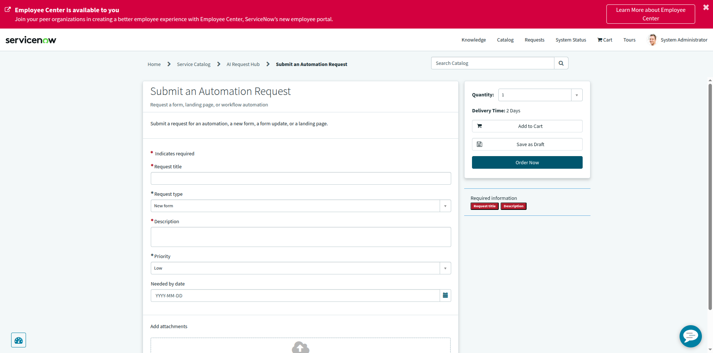
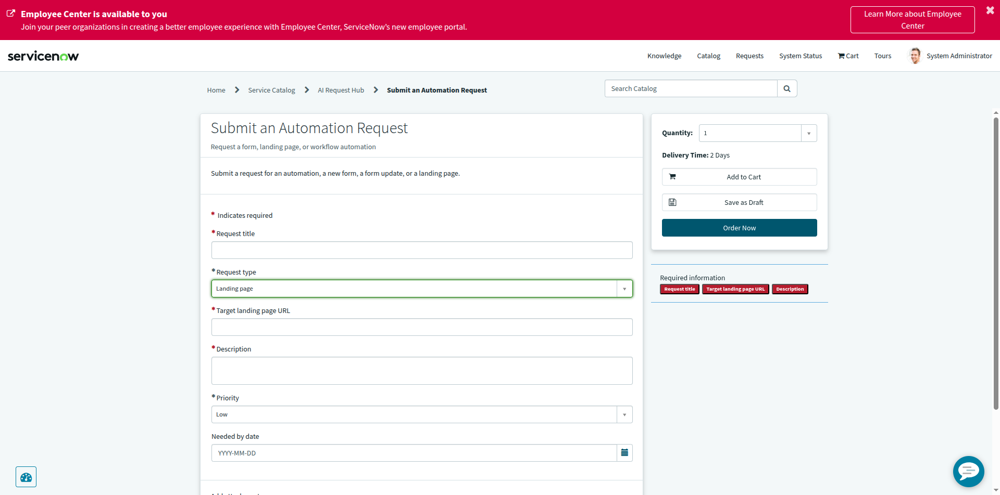

# AI Request Hub — Dynamic "Target landing page URL" Field

| | |
|---|---|
| **Instance** | `dev446072.service-now.com` (PDI) |
| **Action** | Explicitly authorized: add one dynamic variable + one Catalog UI Policy to an existing catalog item |
| **Date** | 2026-10-18 |
| **Tool used** | Playwright MCP (browser automation) |

---

## 1. Update Set

| Field | Value |
|---|---|
| **Name** | `[AI DEMO] AI Request Hub - Catalog v1` |
| **State** | **In Progress** |
| **Current** | ✅ Yes — already existed from the prior build and was already current; no new Update Set was needed |

Not exported (per instructions — "Stop after verification. Do not export XML yet.").

## 2. New Variable

| Field | Value |
|---|---|
| **Name** | `target_landing_page_url` |
| **Question (label)** | Target landing page URL |
| **Type** | Single Line Text |
| **Mandatory (default)** | ❌ false |
| **Order** | 250 — positioned between "Request type" (200) and "Description" (300), exactly as requested |
| **sys_id** | `26eeff7493c41b1075d9f9fbdd03d6e2` |

Full variable order after this change:
1. Request title (100)
2. Request type (200)
3. **Target landing page URL (250)** ← new
4. Description (300)
5. Priority (400)
6. Needed by date (500)

No other existing variable, category, request, or approval was modified.

## 3. Catalog UI Policy

| Field | Value |
|---|---|
| **Name (Short description)** | `Show/require Target landing page URL when Request type is Landing page` |
| **sys_id** | `c85f3fb493c41b1075d9f9fbdd03d603` |
| **Applies to** | A Catalog Item → Submit an Automation Request |
| **Condition** | `request_type is Landing page` |
| **Reverse if false** | ✅ true |
| **On load** | ✅ true |
| **Applies on a Catalog Item view** | ✅ true |

**Catalog UI Policy Action** (one action, using Reverse if false to cover both directions):
| Variable | Mandatory | Visible |
|---|---|---|
| target_landing_page_url | **True** | **True** |

Because "Reverse if false" is checked, when the condition evaluates to false (any Request type other than "Landing page"), the platform automatically reverses the action — making the field **Mandatory = False** and **Visible = False** — with no second policy and no custom script required. This is the standard, out-of-the-box Catalog UI Policy mechanism; no scripting was used.

## 4. Direct portal URL for the catalog item

```
https://dev446072.service-now.com/sp?id=sc_cat_item&sys_id=4e856b7893041b1075d9f9fbdd03d60c&sysparm_category=8545e7f093041b1075d9f9fbdd03d6b6
```

## 5. Portal verification (no submission)

**Test A — "New form" selected:**
"Target landing page URL" is correctly **hidden** — the form shows only Request title, Request type, Description, Priority, and Needed by date.



**Test B — "Landing page" selected:**
"Target landing page URL" correctly **appears** immediately after "Request type", shows a **required red asterisk**, and is now listed in the "Required information" sidebar panel alongside Request title and Description.



**No submission occurred** — "Order Now", "Add to Cart", and "Save as Draft" were not clicked at any point during testing.

---

## Summary of safety boundaries honored

- ✅ No existing catalog item, category, request, approval, or unrelated configuration was modified or deleted.
- ✅ Reused the existing in-progress Update Set rather than creating a redundant one.
- ✅ Added exactly one new variable, positioned immediately after "Request type" as specified.
- ✅ Implemented the show/hide + mandatory/optional behavior using only the standard Catalog UI Policy / Catalog UI Policy Action mechanism — no custom client scripting was needed or used.
- ✅ Verified both states in the Service Portal without submitting a request.
- ✅ No XML export performed.
