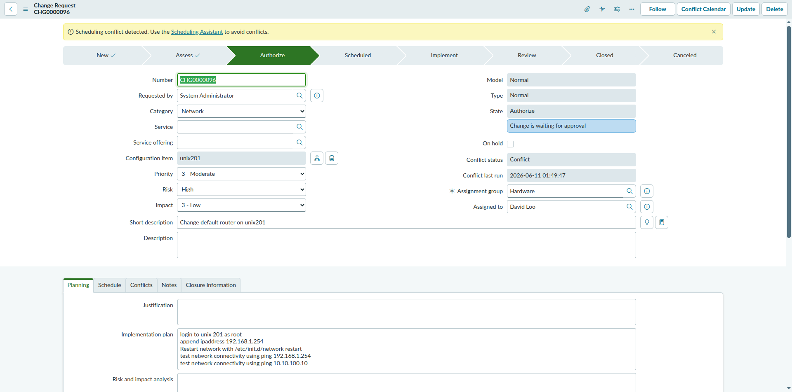

# ServiceNow Change Management — Discovery Report

| | |
|---|---|
| **Instance** | `dev446072.service-now.com` (PDI) |
| **Logged in as** | System Administrator |
| **Task type** | Read-only discovery (no create/edit/import/export/delete performed) |
| **Date** | 2026-10-17 |
| **Tool used** | Playwright MCP (browser automation) |

---

## 1. Is Change Management available?

**Yes.** The standard out-of-the-box Change Management application is active on this instance.

Evidence:
- The `change_request_list.do` table exists and is populated with **105 existing Change Request records**.
- Opening an individual record (`change_request.do?sys_id=...`) renders the full OOB Change Request form, including the standard state flow bar: `New → Assess → Authorize → Scheduled → Implement → Review → Closed / Canceled`.
- Standard related lists are present on the form: `Affected CIs`, `Impacted Services/CIs`, `Approvers`, `Change Tasks`, `CAB Agenda Items`, `Problems`, `Task SLAs`, `Outages`.

**Caveat — navigation menu visibility:** Filtering the top "All" application navigator menu for the keyword `Change` did **not** surface a "Change" (or "Change Management") application group with modules like `Open`, `Create New`, `Change Tasks`, `My Change Requests`, etc. The only matches returned were unrelated items containing the substring "change" (e.g. *Change Verification*, *Change Password*, *Exchange Rates*, *Table Changes*).

This suggests one of the following (not confirmed, would require Admin > Application Menus inspection to verify, which was out of scope for this read-only task):
- The Change module group exists but isn't assigned/pinned for this user's current navigator view, or
- The module labels differ from the stock defaults in this PDI, or
- The navigator's fuzzy filter simply didn't rank the group highly.

The application and data model are fully functional regardless — access is just via direct URL/list navigation rather than a visible "Change" menu group in this instance's current state.

## 2. UI navigation path to create a Change Request

Since the "Change" application menu group wasn't visible in the navigator, the verified working path is:

1. Navigate directly to the Change Request list: `/change_request_list.do`
2. Click the **New** button in the list header toolbar.
   *(Not executed in this session — clicking "New" was blocked by the read-only safety constraint for this discovery task; the list and existing-record form were inspected instead to confirm the form layout.)*
3. This opens a blank Change Request form (`change_request.do`) where you select a **Type** (Standard / Normal / Emergency) and fill in the required fields (see below).
4. Submit via **Submit**/**Save** on the form.

Alternative path once the module is located/pinned: **All menu → Change → Create New**, which is the standard OOB label.

## 3. Change Request types & observed fields

### Visible Change Request types
Confirmed from existing records in the list view:
| Type | Example records |
|---|---|
| **Standard** | CHG0040001, CHG0040002, CHG0030004–8 |
| **Normal** | CHG0000091–96, CHG0002000–01 |
| **Emergency** | CHG0040003–7, CHG0002001 |

*(A 4th option, "Model", appears in the Type dropdown on an existing record but is disabled/not independently selectable — it's tied to template-based change creation, not a standalone type a user picks directly.)*

### Form fields (inspected via an existing Normal-type record, CHG0000096)

**Header fields:**
| Field | Notes |
|---|---|
| Number | Auto-generated, read-only |
| Requested by | Reference (user) |
| Category | Choice: Hardware, Software, Service, System Software, Applications Software, Network, Telecom, Documentation, Other |
| Service | Reference (CMDB service) |
| Service offering | Reference |
| Configuration item | Reference — **read-only on existing record** (may be editable pre-save) |
| Priority | Choice: 1-Critical, 2-High, 3-Moderate, 4-Low |
| Risk | Choice: High, Moderate, Low |
| Impact | Choice: 1-High, 2-Medium, 3-Low |
| Model | Read-only, shows template name if created from one |
| Type | Choice: Standard, Normal, Emergency (locked after creation) |
| State | Read-only progression field (New → Assess → Authorize → Scheduled → Implement → Review → Closed/Canceled) |
| On hold | Checkbox |
| Conflict status | Choice: Not Run, Conflict, No Conflict (system-calculated) |
| Conflict last run | Timestamp |
| Assignment group | Reference |
| Assigned to | Reference (user) |
| Short description | Text — required |
| Description | Text area |

**Planning tab** (flagged by the UI as containing **mandatory fields**, several unpopulated even on this real record):
- Justification *(mandatory, was empty)*
- Implementation plan
- Risk and impact analysis *(mandatory, was empty)*
- Backout plan
- Test plan *(mandatory, was empty)*

**Other tabs present, each also flagged "Contains unpopulated mandatory fields":**
- Schedule
- Conflicts
- Notes
- Closure Information

> Note: ServiceNow's mandatory-field set for Change Request is commonly driven by UI Policies tied to **Type** and **State** (e.g., Normal changes typically require Risk/Impact assessment and a CAB approval path before moving out of "Assess"; Emergency changes often skip CAB). This instance's exact policy configuration wasn't inspected (would require Admin > UI Policies, out of scope for a read-only navigation task).

## 4. Screenshot

Final inspected page (existing Change Request CHG0000096, Planning tab active):

---

## Summary

- ✅ Change Management is installed, active, and contains real data (105 records).
- ⚠️ The application isn't currently surfacing under its own "Change" group in the All-menu navigator for this user — access works fine via direct URL.
- ✅ All three standard types (Standard, Normal, Emergency) are represented.
- ✅ Core form fields and several mandatory-but-unpopulated fields (Justification, Risk and impact analysis, Test plan) were identified.
- 🚫 No records were created, edited, imported, exported, or deleted during this discovery.
