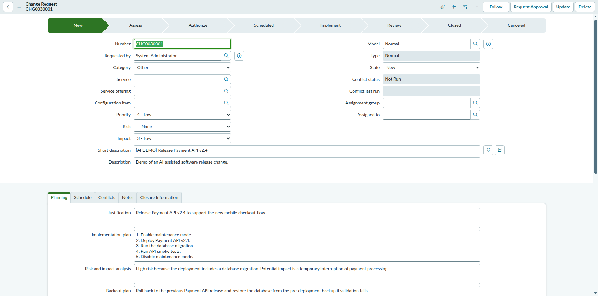
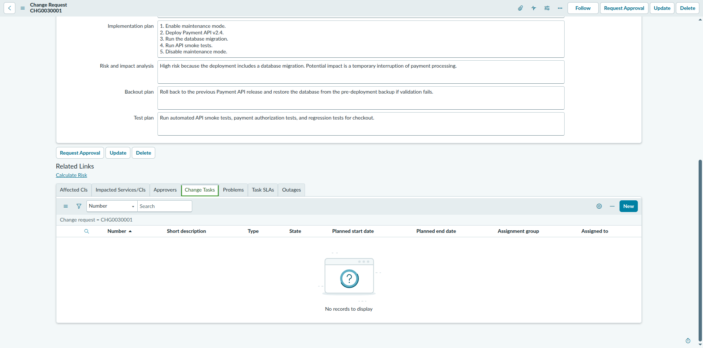
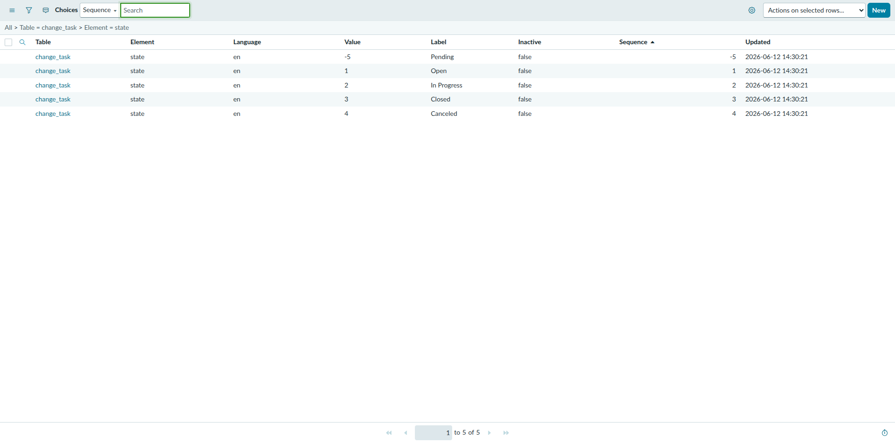
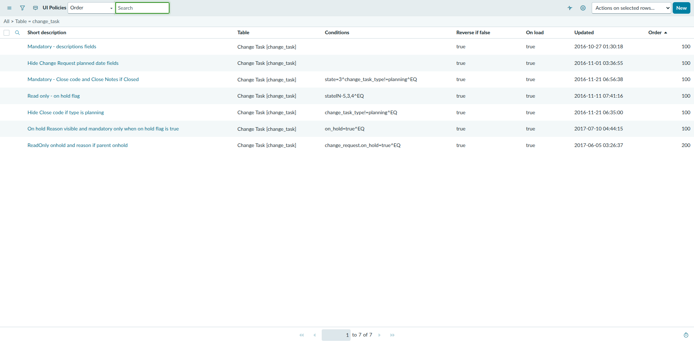
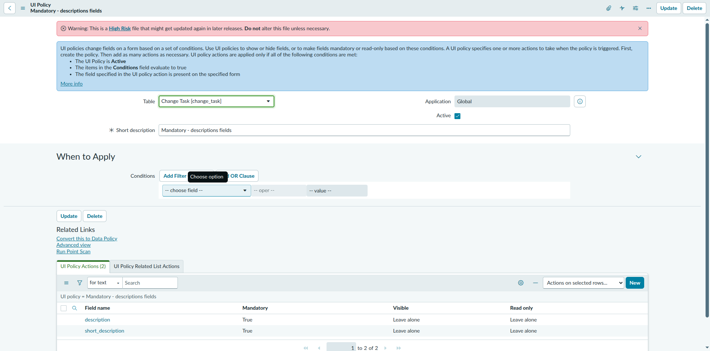

# CHG0030001 — Change Task Discovery Report

| | |
|---|---|
| **Instance** | `dev446072.service-now.com` (PDI) |
| **Record inspected** | CHG0030001 (the `[AI DEMO]` demo Change Request) |
| **Task type** | Read-only discovery — nothing on CHG0030001 was modified |
| **Date** | 2026-10-18 |
| **Tool used** | Playwright MCP (browser automation) |

---

## 1. Does CHG0030001 have a Change Tasks related list?

**Yes.** The "Change Tasks" tab is present among the record's related lists (alongside Affected CIs, Impacted Services/CIs, Approvers, Problems, Task SLAs, Outages). It is currently **empty** ("No records to display") — see screenshot.

## 2. Exact UI path to create a new Change Task

1. Open the Change Request (`change_request.do?sys_id=...`).
2. Scroll to the related lists at the bottom and select the **Change Tasks** tab.
3. Click the **New** button in that related list's toolbar.

This opens a blank Change Task form pre-linked to the parent Change Request (`change_request` field auto-populated).

> Note: I did **not** click "New" — Claude Code's auto-mode classifier blocked it as a potential write action (consistent with your "do not create a task" instruction), so fields/state below were determined from the system's dictionary, UI Policy, and choice-list configuration instead of by opening the live form.

## 3. Required fields & State choices on a blank Change Task

**Required (mandatory) fields — always enforced:**
Found via UI Policy `Mandatory - descriptions fields` on the `change_task` table — no conditions, Active, runs On Load (applies to every Change Task unconditionally):
| Field | Mandatory |
|---|---|
| Short description | ✅ Always |
| Description | ✅ Always |

**Conditionally mandatory fields** (not required on a fresh/blank task, only under these conditions):
| Field | Becomes mandatory when |
|---|---|
| Close code, Close notes | `state = Closed` AND `change_task_type != planning` |
| On hold reason | `on_hold = true` |

No dictionary-level (`sys_dictionary.mandatory = true`) fields exist on `change_task` — all "required" behavior here is UI-Policy driven, same pattern observed on the parent Change Request form.

**Default field values on a new Change Task:**
- `change_task_type` defaults to **`planning`**.

**State choices** (`change_task.state`, from `sys_choice`):
| Value | Label |
|---|---|
| -5 | Pending |
| 1 | Open |
| 2 | In Progress |
| 3 | Closed |
| 4 | Canceled |

(This is a flat choice list, not a stage-bar flow like the parent Change Request's New→Assess→...→Closed progression.)

## 4. Available values for Risk, Impact, Priority on CHG0030001

| Field | Current value | All available options |
|---|---|---|
| **Risk** | `-- None --` | -- None --, High, Moderate, Low |
| **Impact** | `3 - Low` | 1 - High, 2 - Medium, 3 - Low |
| **Priority** | `4 - Low` | -- None --, 1 - Critical, 2 - High, 3 - Moderate, 4 - Low |

## Screenshots

CHG0030001 header fields (Risk / Impact / Priority visible):

CHG0030001 — Change Tasks related list (empty, New button visible):

`change_task.state` choice list:

`change_task` UI Policies list:

"Mandatory - descriptions fields" policy detail (Short description + Description always mandatory):

---

## Summary

- ✅ Change Tasks related list exists on CHG0030001, currently empty.
- ✅ UI path to create one identified (Change Tasks tab → New) — not executed, per instructions.
- ✅ Required fields identified via system metadata (UI Policy), not by opening/submitting a form: Short description and Description are always mandatory; Close code/notes and On hold reason are conditionally mandatory.
- ✅ State choices identified: Pending, Open, In Progress, Closed, Canceled.
- ✅ Risk/Impact/Priority current values and full option sets captured for CHG0030001.
- 🚫 CHG0030001 was not modified. No Change Task was created.
