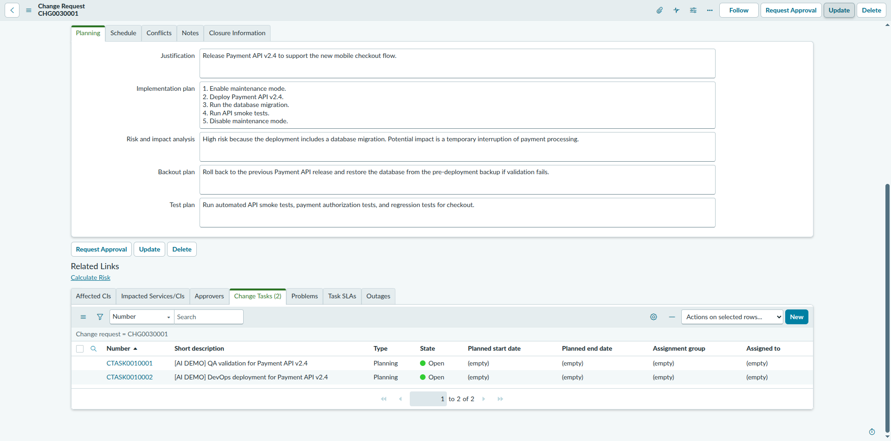

# CHG0030001 — Field Update & Change Task Creation Report

| | |
|---|---|
| **Instance** | `dev446072.service-now.com` (PDI) |
| **Target record** | CHG0030001 (sys_id `8900b0fc9300d71075d9f9fbdd03d699`) |
| **Action** | Explicitly authorized: update 3 fields + create 2 Change Tasks |
| **Date** | 2026-10-18 |
| **Tool used** | Playwright MCP (browser automation) |

---

## Step 1 — CHG0030001 field update

| Field | New value |
|---|---|
| Risk | High |
| Impact | 2 - Medium |
| Priority | 2 - High |

Saved via the **Update** button (not "Request Approval", no state transition). Verified after reload: all three values persisted, and **State remained "New"**.

## Step 2 — Change Tasks created

| Number | sys_id | Short description | Type (default) | State | URL |
|---|---|---|---|---|---|
| **CTASK0010001** | `bdab45709304d71075d9f9fbdd03d66f` | [AI DEMO] QA validation for Payment API v2.4 | Planning | **Open** | `https://dev446072.service-now.com/change_task.do?sys_id=bdab45709304d71075d9f9fbdd03d66f` |
| **CTASK0010002** | `dacb457c93c0d71075d9f9fbdd03d672` | [AI DEMO] DevOps deployment for Payment API v2.4 | Planning | **Open** | `https://dev446072.service-now.com/change_task.do?sys_id=dacb457c93c0d71075d9f9fbdd03d672` |

Both were created via **CHG0030001 → Change Tasks related list → New**, which auto-links `change_request = CHG0030001` and defaults `State = Open`, `Type = Planning` — no changes were needed to those two fields, they already matched the requested values.

Descriptions submitted exactly as specified:
- **CTASK0010001**: "Run API smoke tests, payment authorization tests, and checkout regression tests after deployment. Document test results before the change is closed."
- **CTASK0010002**: "Enable maintenance mode, deploy Payment API v2.4, run the database migration, validate service health, and disable maintenance mode. Use the documented backout plan if validation fails."

No unexpected mandatory fields or confirmation dialogs appeared during either submission.

## Step 3 — Parent state confirmation

Re-opened CHG0030001 after both tasks were created: **State = New** (unchanged). "Request Approval" was never clicked.

## Screenshot

CHG0030001 with both Change Tasks visible in the related list ("Change Tasks (2)"), Planning tab (Risk/Impact/Priority updates reflected in form, not pictured in this crop — see Step 1 verification above):

---

## Safety boundaries honored

- ✅ Only CHG0030001 was edited (field update), no other existing record touched.
- ✅ Exactly two Change Tasks created, both linked to CHG0030001.
- ✅ No approval requested.
- ✅ CHG0030001 never left "New" state.
- ✅ No Update Set, XML import/export, or platform configuration change.
- ✅ No unexpected mandatory field or confirmation encountered — none to report.
