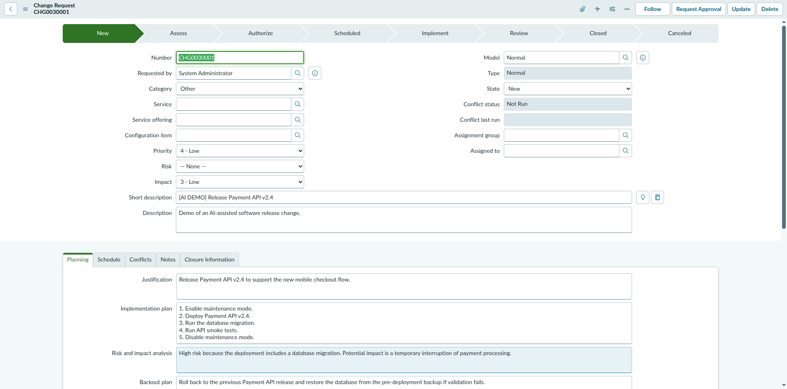

# ServiceNow Demo Change Request — Creation Report

| | |
|---|---|
| **Instance** | `dev446072.service-now.com` (PDI) |
| **Action** | Created ONE new Change Request — explicitly authorized by the user |
| **Date** | 2026-10-17 |
| **Tool used** | Playwright MCP (browser automation) |

---

## Result

| Field | Value |
|---|---|
| **Number** | **CHG0030001** |
| **sys_id** | `8900b0fc9300d71075d9f9fbdd03d699` |
| **Type** | Normal |
| **State** | **New** (initial state — not advanced) |
| **URL** | `https://dev446072.service-now.com/change_request.do?sys_id=8900b0fc9300d71075d9f9fbdd03d699` |

## Navigation path used

Since the "Change" application group wasn't visible in the top All-menu navigator (see [change-management-discovery.md](./change-management-discovery.md)), the record was created via the direct list URL as instructed:

1. `/change_request_list.do` → clicked **New**
2. This opened the modern **Create a change request** picker (`/now/change-management/create-change/...`), which asks you to pick a change type/template first
3. Selected the generic **Normal** type card (not a template) → clicked **Continue**
4. Landed on the classic Change Request form (`change_request.do`) with Type locked to "Normal" and State defaulted to "New"
5. Filled in all fields below and clicked **Submit**

No unexpected required fields or approval prompts were encountered during save. The **Request Approval** button is visible on the saved record but was **not** clicked — the change remains in "New" state only.

## Field values submitted

| Field | Value |
|---|---|
| Short description | `[AI DEMO] Release Payment API v2.4` |
| Description | Demo of an AI-assisted software release change. |
| Justification | Release Payment API v2.4 to support the new mobile checkout flow. |
| Implementation plan | 1. Enable maintenance mode. 2. Deploy Payment API v2.4. 3. Run the database migration. 4. Run API smoke tests. 5. Disable maintenance mode. |
| Risk and impact analysis | High risk because the deployment includes a database migration. Potential impact is a temporary interruption of payment processing. |
| Backout plan | Roll back to the previous Payment API release and restore the database from the pre-deployment backup if validation fails. |
| Test plan | Run automated API smoke tests, payment authorization tests, and regression tests for checkout. |

All other fields (Category, Priority, Risk, Impact, Service, Assignment group, etc.) were left at their system defaults / blank — not set, as they weren't specified.

## Screenshot

## Safety boundaries honored

- ✅ Exactly one record created.
- ✅ No existing Change Request was edited, deleted, canceled, approved, or transitioned.
- ✅ No Update Set created, no XML import, no platform configuration changed.
- ✅ Short description prefixed with `[AI DEMO]`.
- ✅ No unexpected required fields or forced approval encountered — reported here as none occurred.
- ✅ Change Request was not moved beyond its initial "New" state.
